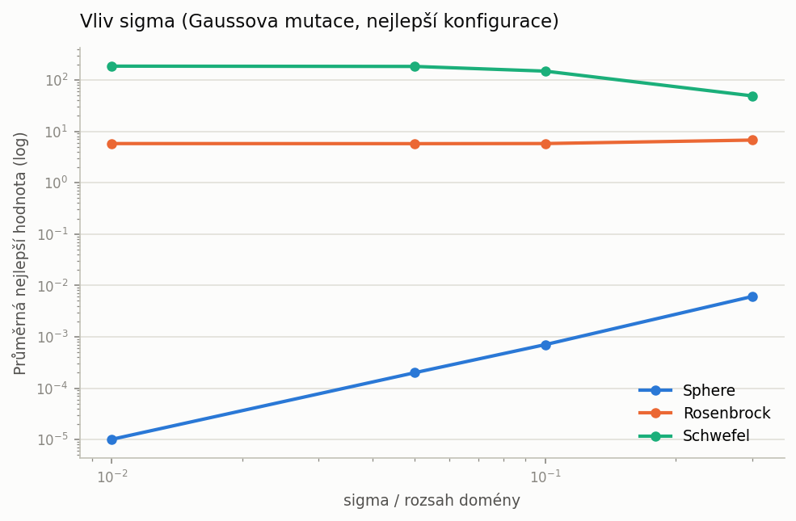
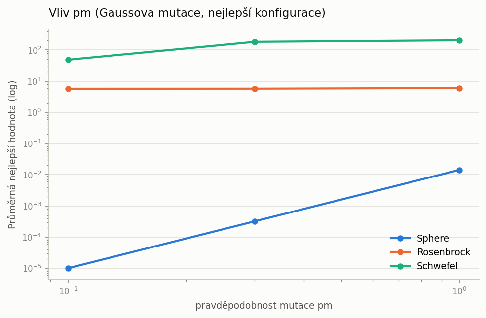
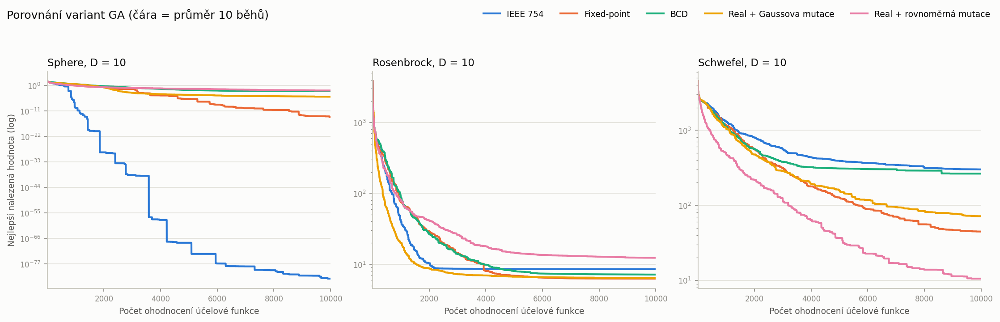

# Úloha 2 – Genetický algoritmus s reálnými parametry

Genetický algoritmus pro optimalizaci funkcí s reálnými parametry. Porovnáno je **pět variant** GA, které se liší jen reprezentací jedince a mutací:

| Varianta | Genotyp | Křížení | Mutace |
|---|---|---|---|
| IEEE 754 | bitový řetězec, 32 bitů na dimenzi (znak + 8 bitů exponent + 23 bitů mantisa) | jednobodové kdekoli v řetězci | bitová |
| Fixed-point | bitový řetězec, 32 bitů na dimenzi (znak + celá část + desetinná část) | jednobodové kdekoli v řetězci | bitová |
| BCD | bitový řetězec, 32 bitů na dimenzi (8 nibblů po 4 bitech) | jednobodové kdekoli v řetězci | bitová |
| Real + Gaussova mutace | vektor reálných čísel | jednobodové mezi dimenzemi | x + N(0, sigma²) |
| Real + rovnoměrná mutace | vektor reálných čísel | jednobodové mezi dimenzemi | nová náhodná hodnota z celého rozsahu |

Testovací funkce (všechny v **10D**, rozpočet **10 000 ohodnocení** účelové funkce, **10 běhů** pro statistiky):

| Funkce | Rozsah | Minimum | Charakter |
|---|---|---|---|
| Sphere | [-5.12, 5.12] | 0 v počátku | separabilní, unimodální, hladká |
| Rosenbrock | [-2.048, 2.048] | 0 v (1, …, 1) | neseparabilní, úzké zakřivené údolí |
| Schwefel | [-500, 500] | 0 v (420.97, …) | multimodální a klamavá, globální minimum daleko od dobrých lokálních |

Obsah:

- [Struktura řešení](#struktura-řešení)
- [Spuštění](#spuštění)
- [Implementace](#implementace)
- [Ladění parametrů](#ladění-parametrů)
- [Výsledky](#výsledky)
- [Proč to dopadlo takto](#proč-to-dopadlo-takto)
- [Závěr](#závěr)

## Struktura řešení

```
02-real-parameter-ga/
├── main.py                  # vstupní bod (CLI): ladění parametrů a finální experimenty
├── ga/                      # algoritmus – nezávisí na reprezentaci ani na konkrétní funkci
│   ├── config.py            # GAConfig – řídicí parametry
│   ├── algorithm.py         # GeneticAlgorithm – generační cyklus s elitismem
│   ├── selection.py         # ruletová a pořadová selekce pro minimalizaci
│   └── evaluator.py         # BudgetedEvaluator – rozpočet ohodnocení a konvergenční křivka
├── representations/         # čím se varianty liší
│   ├── base.py              # rozhraní Representation + jednobodové křížení
│   ├── codecs.py            # IEEE 754, fixed-point a BCD kodeky (32 bitů na dimenzi)
│   ├── binary.py            # bitová reprezentace (sdílená všemi kodeky)
│   └── real.py              # reálná reprezentace s Gaussovou / rovnoměrnou mutací
├── problems/                # Sphere, Rosenbrock, Schwefel
├── experiments/             # opakované běhy, statistiky, grid search, grafy, tabulky
├── tests/                   # jednotkové testy (pytest)
└── results/                 # vygenerované výsledky
```

Algoritmus v `ga/` zná pouze rozhraní `Representation`: umí vytvořit náhodnou populaci, zkřížit dvojice rodičů, zmutovat potomky a dekódovat genotyp na reálný vektor. Porovnávané varianty se proto liší jen tímto jedním objektem, zbytek kódu je sdílený.

## Spuštění

Z kořene repozitáře (virtuální prostředí je popsáno v [hlavním README](../README.md)):

```bash
python 02-real-parameter-ga/main.py all     # ladění parametrů + finální experimenty
python 02-real-parameter-ga/main.py tune    # jen ladění -> results/tuning/, results/best_configs.json
python 02-real-parameter-ga/main.py run     # jen finální běhy -> grafy a statistiky
python -m pytest 02-real-parameter-ga/tests
```

Volitelné parametry: `--runs` (výchozí 10), `--tuning-runs` (výchozí 30), `--seed` (výchozí 42), `--jobs`. Díky pevným semínkům jsou výsledky reprodukovatelné.

## Implementace

### Společná kostra GA

Jedna generace ([`ga/algorithm.py`](ga/algorithm.py)):

1. **Elitismus:** `round(elite_ratio · N)` nejlepších jedinců (alespoň 1) přechází beze změny a znovu se nevyhodnocuje.
2. **Selekce:** vybere se potřebný počet dvojic rodičů.
3. **Křížení:** s pravděpodobností `pc` jednobodové křížení, jinak jsou potomci kopiemi rodičů.
4. **Mutace** podle reprezentace.
5. Potomci se ohodnotí a doplní populaci na velikost `N`.

`BudgetedEvaluator` počítá každé ohodnocení jednoho jedince (včetně počáteční populace), poslední generaci podle potřeby zkrátí a po každém ohodnocení zapíše dosud nejlepší hodnotu. Každý běh tak dá křivku délky přesně 10 000 a křivky deseti běhů lze přímo průměrovat.

### Selekce při minimalizaci

Na rozdíl od úlohy 1 se zde **minimalizuje**, což je pro selekci podstatné:

- *Ruletová selekce* potřebuje nezápornou fitness, a tak se hodnoty nejdřív převrátí: `fitness = f_max − f` v rámci populace (windowing). Nejhorší jedinec tím dostane nulovou pravděpodobnost; jsou-li všichni stejní, vybírá se rovnoměrně.
- *Pořadová selekce* žádný převod nepotřebuje, protože pracuje jen s pořadím. Je také odolná vůči rozsahu hodnot, který se u těchto funkcí mění o několik řádů.

### Binární reprezentace: 32 bitů na dimenzi

Všechny tři kodeky ([`representations/codecs.py`](representations/codecs.py)) mají stejnou délku chromozomu, 10 dimenzí × 32 bitů = **320 bitů**, liší se jen významem bitů. Dekódování vždy vrací hodnotu uvnitř definičního oboru: vzory mimo obor se ořezávají na nejbližší mez.

- **IEEE 754 binary32** – standardní float: 1 bit znaménko, 8 bitů exponent, 23 bitů mantisa. Bity mají extrémně nerovnoměrnou váhu: změna v exponentu násobí hodnotu mocninou dvojky. Vzory NaN a nekonečna se mapují na meze oboru.
- **Fixed-point** – 1 bit znaménko, nejmenší počet celočíselných bitů, který pokryje obor, zbytek na desetinnou část. Pro Schwefel to je 1 + 9 + 22 bitů (krok 2.4e-07), pro Sphere 1 + 3 + 28 bitů (krok 3.7e-09).
- **BCD** – 8 nibblů po 4 bitech: první nibble nese znaménko (hodnota ≥ 8 znamená záporné číslo), zbylých 7 jsou desítkové číslice. Pro Schwefel 3 celé + 4 desetinné číslice (krok 1e-04), pro Sphere 1 + 6 číslic. Platných je jen 10 ze 16 hodnot nibblu; neplatné se opravují modulo 10.

Křížení u binárních variant řeže kdekoli v 320bitovém řetězci, takže může rozdělit i jedno číslo uprostřed. To není chyba, ale vlastnost bitové reprezentace.

### Reálná reprezentace

Genotypem je přímo vektor 10 reálných čísel. Jednobodové křížení řeže **mezi dimenzemi**, takže nikdy nerozbije jedno číslo. Mutace má dvě varianty podle zadání:

- **Gaussova:** `x + N(0, sigma²)`, kde sigma je zadána jako podíl šířky oboru (např. 0.05 × rozsah). Jde o lokální krok, jehož velikost je laditelný parametr.
- **Rovnoměrná:** gen se nahradí novou náhodnou hodnotou z celého oboru, tedy restart jedné souřadnice.

Zmutované hodnoty se ořezávají zpět do oboru.

## Ladění parametrů

Pro každou dvojici (funkce, varianta) proběhl grid search ([`experiments/tuning.py`](experiments/tuning.py)):

| Parametr | Hodnoty |
|---|---|
| velikost populace `N` | 20, 50, 100 |
| podíl elitismu | 10 %, 20 % |
| selekce | ruletová, pořadová |
| pravděpodobnost křížení `pc` | 0.8, 1.0 |
| `pm` – binární varianty (na bit) | 1/320 ≈ 0.0031, 0.01, 0.03 |
| `pm` – reálné varianty (na gen) | 0.1, 0.3, 1.0 |
| `sigma / rozsah` – Gaussova mutace | 0.01, 0.05, 0.1, 0.3 |

Mutace znamená v každé reprezentaci něco jiného, proto se liší i její mřížka: u binárních variant je `pm` pravděpodobnost na jeden bit (1/320 odpovídá v průměru jednomu převrácenému bitu na chromozom), u reálných na jeden gen (0.1 = v průměru jedna souřadnice z deseti).

Celkem 1 728 dvojic (instance, konfigurace) × 30 běhů, tedy přes 50 000 běhů, zhruba 4,5 minuty na 8 jádrech. Konfigurace se řadí podle průměrné finální hodnoty, při shodě podle mediánu. Ladění používá jiná semínka než finální běhy.

Kompletní žebříčky jsou v [`results/tuning/*.csv`](results/tuning/), top 5 pro každou instanci v [`results/tuning/top_configs.md`](results/tuning/top_configs.md), vliv jednotlivých parametrů v `results/tuning/effects_<varianta>.md`.

### Vliv sigma a pravděpodobnosti mutace (Gaussova mutace)

Zadání žádá experiment se sigma a pravděpodobností mutace. Grafy ukazují, čeho nejlépe dosáhne konfigurace s danou hodnotou parametru (ostatní parametry vyladěné):





Vyladěná sigma se pro každou funkci liší a přesně odpovídá jejímu charakteru:

| Funkce | nejlepší sigma | proč |
|---|---|---|
| Sphere | 0.01 × rozsah | hladká miska, stačí jemné dolaďování; výsledek se zhoršuje monotónně s rostoucí sigma (0.01 → 1e-05, 0.3 → 6e-03) |
| Rosenbrock | 0.05 × rozsah | na velikosti kroku skoro nezáleží: 0.01, 0.05 i 0.1 dají shodně ≈ 5.75, teprve 0.3 zhoršuje na 6.74 |
| Schwefel | 0.3 × rozsah | mnoho lokálních minim, krok musí být dost velký, aby se z nich dalo utéct: 0.01 → 185, 0.3 → 48.9 |

Pravděpodobnost mutace vychází nejlépe `pm = 0.1`, tedy v průměru jedna zmutovaná souřadnice z deseti, a to u všech tří funkcí. Při `pm = 1.0` (mutují se všechny souřadnice najednou) se výsledek zhorší nejvíc u funkce Sphere (1e-05 → 1.4e-02, tedy o tři řády), u Schwefela zhruba čtyřnásobně (48.9 → 204) a u Rosenbrocka jen mírně (5.74 → 6.03). Mutace všech souřadnic naráz rozbíjí i ty části řešení, které už byly dobré, a nejvíc to vadí tam, kde je potřeba jemné dolaďování.

### Ostatní parametry

- **Elitismus 20 % je lepší než 10 %** téměř všude, nejvýrazněji u rovnoměrné mutace na Schwefelovi (208 vs. 395). Ta je destruktivní a elita je jediné, co drží nalezené řešení.
- **Pořadová selekce** je lepší u reálných variant (Rosenbrock, Gaussova mutace: 8.03 vs. 9.26 u rulety). U binárních variant je rozdíl malý, u BCD vychází o něco lépe ruleta. Pořadová selekce nezávisí na rozsahu hodnot, který se u těchto funkcí mění o několik řádů, takže je bezpečnější volbou.
- **Velikost populace** závisí na variantě: binární varianty na těžších funkcích preferují velkou populaci (fixed-point na Schwefelovi: 115 při N = 100 vs. 249 při N = 20), zatímco rovnoměrná mutace těží z malé populace a většího počtu generací (231 při N = 20 vs. 367 při N = 100).
- **Pravděpodobnost křížení** (0.8 vs. 1.0) je prakticky bez vlivu, rozdíly jsou do 10 %.

## Výsledky

10 nezávislých běhů pro každou dvojici (funkce, varianta) s vyladěnou konfigurací, 10D, 10 000 ohodnocení, semínka 42–51. Minimum všech tří funkcí je 0, takže nižší hodnota je lepší. Tabulka je vygenerována do [`results/stats.md`](results/stats.md).

| Funkce | Varianta | Nejlepší | Nejhorší | Průměr | Medián | Sm. odchylka | Nastavení |
|---|---|---|---|---|---|---|---|
| Sphere | IEEE 754 | 1.162e-86 | 3.345e-83 | 4.932e-84 | 4.684e-85 | 1.081e-83 | N=20, elite=20%, rank, pc=1, pm=0.003125 |
| Sphere | Fixed-point | 2.359e-16 | 2.452e-13 | 2.636e-14 | 1.096e-15 | 7.694e-14 | N=20, elite=20%, rank, pc=1, pm=0.003125 |
| Sphere | BCD | 2.634e-05 | 0.04016 | 0.004314 | 0.0003082 | 0.0126 | N=100, elite=20%, rank, pc=1, pm=0.01 |
| Sphere | Real + Gaussova mutace | 5.76e-06 | 3.785e-05 | 1.574e-05 | 1.151e-05 | 1.151e-05 | N=20, elite=20%, rank, pc=1, pm=0.1, sigma=0.01*rozsah |
| Sphere | Real + rovnoměrná mutace | 0.001611 | 0.01889 | 0.007761 | 0.006029 | 0.005348 | N=20, elite=20%, rank, pc=1, pm=0.1 |
| Rosenbrock | IEEE 754 | 6.194 | 8.962 | 8.508 | 8.727 | 0.8292 | N=100, elite=20%, rank, pc=1, pm=0.003125 |
| Rosenbrock | Fixed-point | 3.351 | 7.735 | 6.271 | 6.644 | 1.471 | N=100, elite=20%, rank, pc=0.8, pm=0.01 |
| Rosenbrock | BCD | 5.685 | 8.072 | 7.154 | 7.163 | 0.8802 | N=100, elite=20%, rank, pc=1, pm=0.01 |
| Rosenbrock | Real + Gaussova mutace | 0.1668 | 7.735 | 6.363 | 7.247 | 2.276 | N=20, elite=10%, rank, pc=1, pm=0.1, sigma=0.05*rozsah |
| Rosenbrock | Real + rovnoměrná mutace | 1.373 | 61.28 | 12.33 | 7.549 | 17.35 | N=100, elite=20%, rank, pc=1, pm=0.1 |
| Schwefel | IEEE 754 | 5.276 | 779.5 | 300.5 | 274.1 | 232.9 | N=100, elite=10%, roulette, pc=1, pm=0.003125 |
| Schwefel | Fixed-point | 1.551 | 134.2 | 44.69 | 17.46 | 54.34 | N=100, elite=20%, rank, pc=1, pm=0.03 |
| Schwefel | BCD | 55.94 | 686.5 | 264.1 | 237.3 | 179.7 | N=100, elite=20%, rank, pc=0.8, pm=0.01 |
| Schwefel | Real + Gaussova mutace | 4.229 | 242.8 | 71.6 | 24.74 | 81.41 | N=100, elite=20%, rank, pc=1, pm=0.1, sigma=0.3*rozsah |
| Schwefel | Real + rovnoměrná mutace | 5.066 | 17.07 | 10.54 | 10.68 | 4.234 | N=20, elite=20%, rank, pc=0.8, pm=0.1 |

### Konvergenční grafy

Čára je průměr nejlepší dosud nalezené hodnoty přes 10 běhů, osa y je logaritmická. Hodnoty se neořezávají, proto je u funkce Sphere rozsah osy přes 80 řádů – to samo o sobě je výsledek.



Samostatné grafy: [Sphere](results/plots/sphere.png), [Rosenbrock](results/plots/rosenbrock.png), [Schwefel](results/plots/schwefel.png).

Pořadí variant podle průměru:

| Funkce | 1. | 2. | 3. | 4. | 5. |
|---|---|---|---|---|---|
| Sphere | IEEE 754 (5e-84) | Fixed-point (3e-14) | Real + Gauss (2e-05) | BCD (4e-03)* | Real + rovnoměrná (8e-03) |
| Rosenbrock | Fixed-point (6.27) | Real + Gauss (6.36) | BCD (7.15) | IEEE 754 (8.51) | Real + rovnoměrná (12.3) |
| Schwefel | Real + rovnoměrná (10.5) | Fixed-point (44.7) | Real + Gauss (71.6) | BCD (264) | IEEE 754 (300) |

\* Průměr BCD na Sphere (4e-03) táhne nahoru jeden odlehlý běh (nejhorší 4e-02); podle mediánu (3e-04 proti 6e-03 u rovnoměrné mutace) je náskok BCD ještě výraznější.

## Proč to dopadlo takto

**IEEE 754 je extrémem v obou směrech.** Exponent dává mutaci multiplikativní účinek: převrácení jednoho bitu exponentu vydělí nebo vynásobí souřadnici mocninou dvojky. Když leží optimum přesně v nule (Sphere), je to obrovská výhoda – algoritmus zmenšuje souřadnice po řádech a dostane se k hodnotám kolem 1e-84, kam se žádná jiná reprezentace s 32 bity dostat nemůže. Jakmile ale optimum v nule neleží (Rosenbrock v 1, Schwefel v 420.97), je stejná vlastnost přítěží: sousední hodnoty v prostoru řešení nejsou sousedními bitovými vzory, mutace exponentu odhodí jedince někam úplně jinam a zhruba polovina náhodných vzorů padne mimo definiční obor a ořeže se na mez. Na Schwefelovi je proto IEEE 754 nejhorší ze všech variant. Výsledek na Sphere je tedy spíš vlastností této testovací funkce než obecnou výhodou reprezentace.

**Fixed-point je nejvyrovnanější binární reprezentace.** Mapování bitů na hodnoty je monotónní a rozlišení je v celém oboru stejné, takže význam bitů klesá plynule: horní bity dělají hrubé skoky, spodní jemné dolaďování. Je nejlepší binární variantou na Rosenbrockovi i na Schwefelovi a na Sphere narazí na svoje rozlišení: krok 2^-28 ≈ 3.7e-09, takže souřadnice na úrovni kvantizačního kroku dávají hodnotu kolem 1e-16 – a nejlepší nalezená hodnota je 2.4e-16. Dál se tato reprezentace principiálně dostat nemůže.

**BCD zaostává za fixed-pointem na všech třech funkcích** (4e-03 vs. 3e-14 na Sphere, 7.15 vs. 6.27 na Rosenbrockovi, 264 vs. 44.7 na Schwefelovi) a jde to vysvětlit přímo z její definice. Za prvé plýtvá kódy: platných je jen 10 z 16 hodnot nibblu, tedy 37,5 % kombinací je neplatných a musí se opravovat (modulo 10), čímž mutace přestává být symetrická. Za druhé má na stejných 32 bitech výrazně horší rozlišení – na Schwefelovi krok 1e-04 proti 2.4e-07 u fixed-pointu, tedy o tři řády. Za třetí jsou skoky nerovnoměrné i uvnitř číslice: převrácení horního bitu nibblu mění číslici o 8. BCD je dobře čitelné pro člověka, ale jako prohledávací prostor je z testovaných binárních kódování nejméně vhodné – horší než IEEE 754 je jen na Sphere, kde IEEE 754 těží ze svého speciálního chování kolem nuly.

**Reálná reprezentace s Gaussovou mutací je klasické lokální prohledávání** a chová se podle očekávání: funguje spolehlivě všude, ale její výkon stojí a padá s nastavením sigma, protože sigma je přímo velikost kroku. Na Rosenbrockovi dosáhla nejlepšího jednotlivého běhu ze všech variant (0.167), ale zároveň má velký rozptyl (medián 7.25 proti nejlepšímu běhu 0.167) – podle toho, zda se běh trefil do zakřiveného údolí. Na této funkci je přitom na velikosti sigma skoro nezávislá, protože ji nebrzdí velikost kroku, ale směr: údolí je zakřivené a nezávislá mutace jednotlivých souřadnic po něm neumí jít.

**Reálná reprezentace s rovnoměrnou mutací je protipól:** mutace není krok, ale restart jedné souřadnice. Na Sphere a Rosenbrockovi proto nedokáže doladit řešení a končí nejhůř. Na Schwefelovi je naopak jasně nejlepší (10.5 proti 44.7 u druhé varianty), protože Schwefel je **separabilní** – příspěvek každé souřadnice je nezávislý na ostatních. Náhodný restart jedné souřadnice v kombinaci s elitismem je pak vlastně náhodné prohledávání po souřadnicích: dobrá hodnota souřadnice se zachová a ostatní se zkoušejí dál. Mnohonásobná lokální minima, která Gaussovu mutaci brzdí, přitom restartu vůbec nevadí.

Celkově se potvrzuje, že u GA nejde o „lepší“ a „horší“ reprezentaci obecně, ale o to, jak dobře struktura reprezentace odpovídá struktuře úlohy: sousední řešení v prostoru by měla být sousední i v genotypu a mutace by měla dělat krok přiměřený tomu, co funkce potřebuje.

## Závěr

- **Nejlepší volbou napříč úlohami je fixed-point** mezi binárními reprezentacemi a **reálná reprezentace s Gaussovou mutací** mezi reálnými. Obě mají rovnoměrné rozlišení a mutaci, jejíž velikost odpovídá vzdálenosti v prostoru řešení.
- **IEEE 754 a BCD se pro GA nehodí.** IEEE 754 kvůli extrémně nerovnoměrné váze bitů (s výjimkou úloh s optimem v nule) a BCD kvůli neplatným kódům a horšímu rozlišení při stejném počtu bitů.
- **Vhodná varianta závisí na funkci.** Multimodální separabilní Schwefel vyhrála rovnoměrná mutace, hladkou Sphere IEEE 754 a úzké údolí Rosenbrocka fixed-point s Gaussovou mutací těsně za ním.
- **Nejdůležitější laditelné parametry byly `pm` a `sigma`**: `pm = 1/D` (jedna souřadnice na potomka) a sigma podle charakteru funkce (0.01 pro hladkou, 0.3 pro multimodální). Elitismus a velikost populace mají menší, ale měřitelný vliv, pravděpodobnost křížení prakticky žádný.
