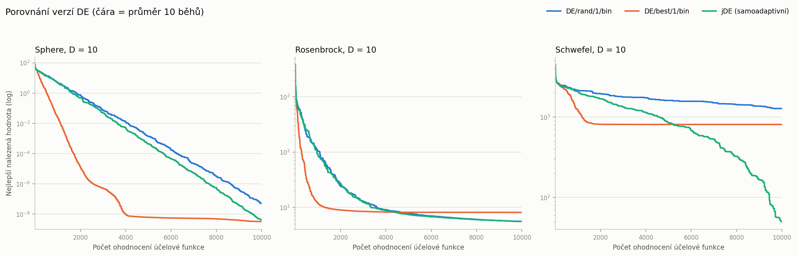
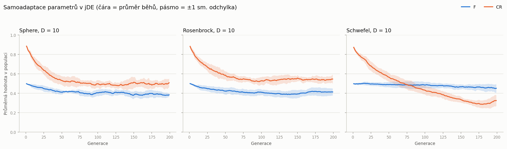
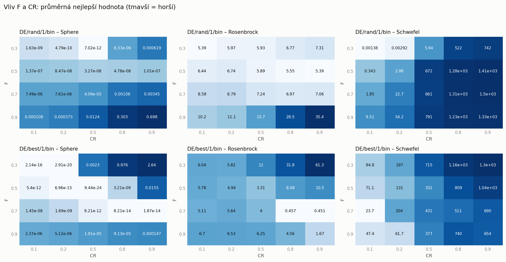

# Úloha 3 – Diferenciální evoluce

Implementace diferenciální evoluce (DE) ve třech verzích podle zadání a ukázka jejich konvergence na testovacích funkcích.

| Verze | Mutace | Křížení | Parametry |
|---|---|---|---|
| DE/rand/1/bin | v = x_r1 + F·(x_r2 − x_r3) | binomiální | F = 0.5, CR = 0.8 (pevné) |
| DE/best/1/bin | v = x_best + F·(x_r1 − x_r2) | binomiální | F = 0.5, CR = 0.8 (pevné) |
| jDE | rand/1 | binomiální | samoadaptivní F ∈ [0.1, 0.9] a CR ∈ [0, 1], tau1 = tau2 = 0.1, start F = 0.5, CR = 0.9 |

Testovací funkce jsou stejné jako v [úloze 2](../02-real-parameter-ga/), takže jsou výsledky DE a GA přímo porovnatelné: **Sphere**, **Rosenbrock** a **Schwefel**, všechny v **10D**, rozpočet **10 000 ohodnocení** účelové funkce a **10 nezávislých běhů**. Velikost populace NP = 50, tedy 200 generací.

Obsah:

- [Struktura řešení](#struktura-řešení)
- [Spuštění](#spuštění)
- [Implementace](#implementace)
- [Výsledky](#výsledky)
- [Samoadaptace v jDE](#samoadaptace-v-jde)
- [Vliv parametrů F a CR](#vliv-parametrů-f-a-cr)
- [Závěr](#závěr)

## Struktura řešení

```
03-differential-evolution/
├── main.py                  # vstupní bod (CLI): finální experimenty a studie F x CR
├── de/                      # algoritmus
│   ├── config.py            # DEConfig – řídicí parametry
│   ├── algorithm.py         # DifferentialEvolution – mutace, křížení, selekce
│   ├── strategies.py        # rand/1, best/1 a výběr donorů
│   ├── crossover.py         # binomiální křížení
│   ├── parameters.py        # pevné parametry vs. samoadaptace jDE
│   ├── variants.py          # tři porovnávané verze s doporučeným nastavením
│   └── evaluator.py         # BudgetedEvaluator – rozpočet ohodnocení a konvergenční křivka
├── problems/                # Sphere, Rosenbrock, Schwefel
├── experiments/             # opakované běhy, statistiky, studie F x CR, grafy, tabulky
├── tests/                   # jednotkové testy (pytest)
└── results/                 # vygenerované výsledky
```

## Spuštění

Potřebné balíčky: `numpy` a `matplotlib` (pro testy navíc `pytest`). Příprava prostředí z kořene repozitáře (viz [hlavní README](../README.md)):

```bash
python3 -m venv .venv
source .venv/bin/activate
pip install -r requirements.txt
```

Spuštění z kořene repozitáře:

```bash
python 03-differential-evolution/main.py all      # vše (do minuty)
python 03-differential-evolution/main.py run      # 10 běhů na každou dvojici (funkce, verze)
python 03-differential-evolution/main.py study    # studie vlivu F a CR
python -m pytest 03-differential-evolution/tests
```

Volitelné parametry: `--runs` (výchozí 10), `--np-size` (velikost populace), `--seed` (výchozí 42), `--jobs`. Díky pevným semínkům jsou výsledky reprodukovatelné.

## Implementace

### Hlavní cyklus

DE má oproti genetickému algoritmu obrácené pořadí operací – **mutace → křížení → selekce** ([`de/algorithm.py`](de/algorithm.py)). V jedné generaci se pro každého jedince x_i:

1. **Mutace:** vyberou se vzájemně různí donoři, různí i od x_i, a z nich se složí mutační (šumový) vektor v_i. Výběr je vektorizovaný: v matici náhodných klíčů se zakáže diagonála (jedinec nikdy není svým donorem) a v každém řádku se vezmou indexy nejmenších klíčů, což je rovnoměrně náhodná podmnožina. Pořadí sloupců se ještě zamíchá, aby role (bázový vektor a dva rozdílové) byly přiděleny náhodně.
2. **Křížení:** binomiální – každý parametr se vezme z mutanta s pravděpodobností CR, jinak z rodiče. Jeden náhodně zvolený parametr (j_rand) se z mutanta bere vždy, takže zkušební vektor nikdy není přesnou kopií rodiče.
3. **Ošetření mezí:** zkušební vektor se ořízne zpět do definičního oboru.
4. **Selekce:** zkušební vektor nahradí rodiče, pokud **není horší** (`f(u) ≤ f(x)`). DE je tím přirozeně elitistická, populace se nikdy nezhorší. Podmínku s „≤“ (místo „<“) doporučuje přednáška: při shodné funkční hodnotě se preferuje nový bod, což pomáhá projít plochými oblastmi.

`BudgetedEvaluator` počítá každé ohodnocení jednoho jedince (včetně počáteční populace), poslední generaci podle potřeby zkrátí a po každém ohodnocení zapíše dosud nejlepší hodnotu. Každý běh tak dá křivku délky přesně 10 000 a křivky deseti běhů lze přímo průměrovat.

### Rozdíl mezi verzemi

Všechny tři verze sdílejí stejný cyklus a liší se jen dvěma objekty:

- **Strategie mutace** ([`de/strategies.py`](de/strategies.py)): `rand/1` staví mutanta kolem náhodně zvoleného jedince, `best/1` kolem dosud nejlepšího. `rand/1` potřebuje tři donory, `best/1` dva.
- **Řízení parametrů** ([`de/parameters.py`](de/parameters.py)): `FixedParameters` drží F a CR po celý běh, `SelfAdaptiveParameters` implementuje jDE.

Z variant křížení je implementováno binomiální, které všechny tři zadané verze používají (zápis `/bin`); exponenciální křížení zadání nevyžaduje.

### jDE

Každý jedinec nese vlastní dvojici (F_i, CR_i), na začátku F = 0.5 a CR = 0.9. Před vytvořením zkušebního vektoru se s pravděpodobností tau1 = 0.1 přegeneruje F z rovnoměrného rozdělení na [0.1, 0.9] a s pravděpodobností tau2 = 0.1 se přegeneruje CR z [0, 1]. Je-li zkušební vektor úspěšný, postupuje do další generace i se svou (případně novou) dvojicí parametrů; pokud neuspěje, rodiči zůstávají jeho původní hodnoty. Úspěšná nastavení se tak populací šíří sama, bez jakéhokoli dalšího učícího mechanismu.

Rozsah F odpovídá zadání (0.1 až 0.9); původní Brestova formulace `F = F_l + rand·F_u` dává rozsah [0.1, 1.0].

## Výsledky

10 nezávislých běhů pro každou dvojici (funkce, verze), 10D, 10 000 ohodnocení, semínka 42–51. Minimum všech tří funkcí je 0, nižší hodnota je lepší. Tabulka je vygenerována do [`results/stats.md`](results/stats.md).

| Funkce | Verze | Nejlepší | Nejhorší | Průměr | Medián | Sm. odchylka | Nastavení |
|---|---|---|---|---|---|---|---|
| Sphere | DE/rand/1/bin | 1.13e-08 | 9.102e-08 | 4.777e-08 | 4.075e-08 | 2.465e-08 | NP=50, rand1/bin, F=0.5, CR=0.8 |
| Sphere | DE/best/1/bin | 9.829e-34 | 2.808e-08 | 3.212e-09 | 1.415e-15 | 8.789e-09 | NP=50, best1/bin, F=0.5, CR=0.8 |
| Sphere | jDE (samoadaptivní) | 5.662e-10 | 7.678e-09 | 4.135e-09 | 3.802e-09 | 2.402e-09 | NP=50, jDE (rand/1/bin), F0=0.5 z [0.1, 0.9], CR0=0.9, tau1=tau2=0.1 |
| Rosenbrock | DE/rand/1/bin | 4.879 | 6.092 | 5.548 | 5.485 | 0.3882 | NP=50, rand1/bin, F=0.5, CR=0.8 |
| Rosenbrock | DE/best/1/bin | 3.415 | 17.11 | 8.079 | 7.872 | 3.785 | NP=50, best1/bin, F=0.5, CR=0.8 |
| Rosenbrock | jDE (samoadaptivní) | 4.81 | 6.336 | 5.53 | 5.467 | 0.4974 | NP=50, jDE (rand/1/bin), F0=0.5 z [0.1, 0.9], CR0=0.9, tau1=tau2=0.1 |
| Schwefel | DE/rand/1/bin | 966.3 | 1485 | 1278 | 1325 | 184.7 | NP=50, rand1/bin, F=0.5, CR=0.8 |
| Schwefel | DE/best/1/bin | 118.9 | 1289 | 808.9 | 839.7 | 355.1 | NP=50, best1/bin, F=0.5, CR=0.8 |
| Schwefel | jDE (samoadaptivní) | 3.782 | 160 | 50.14 | 35 | 53.08 | NP=50, jDE (rand/1/bin), F0=0.5 z [0.1, 0.9], CR0=0.9, tau1=tau2=0.1 |

### Konvergenční grafy

Čára je průměr nejlepší dosud nalezené hodnoty přes 10 běhů, osa y je logaritmická.



Samostatné grafy: [Sphere](results/plots/sphere.png), [Rosenbrock](results/plots/rosenbrock.png), [Schwefel](results/plots/schwefel.png).

**Co z grafů plyne:**

- **Sphere (hladká, unimodální):** všechny tři verze konvergují exponenciálně (v logaritmické ose přímka). `best/1` je zdaleka nejrychlejší – kolem 4 000 ohodnocení je o několik řádů níž než ostatní – protože staví mutanty kolem nejlepšího jedince a populace se rychle stáhne k optimu. Pak ale přestane klesat: populace ztratila rozmanitost, rozdílové vektory jsou krátké a algoritmus už nemá čím dělat kroky.
- **Rosenbrock (úzké zakřivené údolí):** všechny verze se rychle dostanou do údolí (~10) a pak se téměř zastaví. `best/1` je nejhorší v průměru (8.08) a má největší rozptyl (nejhorší běh 17.1) – předčasně zkonverguje mimo správnou větev údolí. `rand/1` a jDE skončí shodně kolem 5.5 a stabilně (sm. odchylka 0.39 resp. 0.50).
- **Schwefel (multimodální, separabilní):** obě klasické verze s doporučeným CR = 0.8 selhávají (1278 a 809), zatímco jDE se dostane na 50.1 a v nejlepším běhu až na 3.78. Důvod není v mutaci, ale v CR – viz [studie F a CR](#vliv-parametrů-f-a-cr) níže.

## Samoadaptace v jDE

Průměrné F a CR v populaci během běhu (průměr přes 10 běhů, pásmo ±1 směrodatná odchylka):



Adaptace není kosmetická, algoritmus si parametry skutečně přizpůsobuje úloze:

- **F** klesne z počátečních 0.5 zhruba na 0.4 (0.38 u Sphere, 0.45 u Schwefela) a tam zůstane. Menší krok se vyplácí ve fázi dolaďování.
- **CR** se chová podle charakteru funkce. U funkcí Sphere a Rosenbrock se ustálí kolem 0.5, u **Schwefela klesá až k 0.3**, protože je separabilní a vyplácí se měnit málo souřadnic najednou.

jDE tedy samo najde to, co přednáška doporučuje ručně (nízké CR pro separabilní funkce) – a právě proto jako jediná verze na Schwefelovi uspěje, i když startuje z „nevhodného“ CR = 0.9.

## Vliv parametrů F a CR

Doporučené hodnoty z materiálů (F = 0.5, CR = 0.8) jsem ověřil mřížkou F × CR pro obě klasické verze, 10 běhů na bod ([`results/parameter_study.csv`](results/parameter_study.csv)). Každý panel má vlastní barevnou škálu, tmavší znamená horší:



| Funkce | Verze | Nejlepší bod mřížky | Výsledek | Doporučené F = 0.5, CR = 0.8 |
|---|---|---|---|---|
| Sphere | rand/1 | F = 0.3, CR = 0.5 | 7.0e-12 | 4.8e-08 |
| Sphere | best/1 | F = 0.5, CR = 0.5 | 9.4e-24 | 3.2e-09 |
| Rosenbrock | rand/1 | F = 0.5, CR = 0.9 | 5.39 | 5.55 |
| Rosenbrock | best/1 | F = 0.7, CR = 0.9 | 0.451 | 8.08 |
| Schwefel | rand/1 | F = 0.3, CR = 0.1 | **0.00138** | 1278 |
| Schwefel | best/1 | F = 0.7, CR = 0.1 | 23.7 | 809 |

**Pozorování:**

- **CR je u těchto úloh důležitější než F.** Na Schwefelovi zlepší snížení CR z 0.8 na 0.1 výsledek `rand/1` z 1278 na 0.0014, tedy o šest řádů. To přesně odpovídá doporučení z přednášky „CR = 0.2 pro separabilní funkce“: u separabilní funkce lze optimalizovat souřadnice téměř nezávisle, takže je lepší měnit jen málo z nich najednou a nerozbíjet už nalezené.
- **Opačně u neseparabilního Rosenbrocka**, kde parametry spolu souvisí: tam je nejlepší vysoké CR = 0.9 a nejhorší naopak nízké.
- **Vysoké F = 0.9 škodí** téměř všude (u `rand/1` na Sphere při CR = 0.1 je o pět řádů horší než F = 0.3) – velké kroky brání dolaďování. Výjimkou je `best/1` na Rosenbrockovi, kde větší F kompenzuje ztrátu rozmanitosti.
- Doporučené nastavení F = 0.5, CR = 0.8 je tedy rozumný **kompromis pro neznámou funkci**, ale ani na jedné z testovaných funkcí není optimální.

### Srovnání s genetickým algoritmem z úlohy 2

Stejné funkce, stejná dimenze, stejný rozpočet i počet běhů (průměr z 10 běhů):

| Funkce | Nejlepší GA z úlohy 2 | DE s doporučeným nastavením | DE s nejlepším nalezeným F a CR |
|---|---|---|---|
| Sphere | 4.9e-84 (IEEE 754) | 3.2e-09 (best/1) | 9.4e-24 (best/1) |
| Rosenbrock | 6.27 (fixed-point) | 5.53 (jDE) | 0.451 (best/1) |
| Schwefel | 10.5 (real + rovnoměrná mutace) | 50.1 (jDE) | 0.00138 (rand/1) |

DE je s vhodným nastavením na Rosenbrockovi i Schwefelovi řádově lepší než nejlepší varianta GA, a to při stejném rozpočtu. Zároveň je vidět, že srovnání není zadarmo: GA v úloze 2 měl parametry vyladěné mřížkou, DE s „univerzálním“ doporučeným nastavením na Schwefelovi prohrává a vyhraje až po úpravě CR (nebo s jDE, která si ji udělá sama). Výsledek na Sphere zůstává doménou IEEE 754 kódování, protože jeho exponent umí dosáhnout extrémně malých hodnot – to je ale vlastnost té konkrétní funkce s optimem přesně v nule, ne obecná výhoda.

## Závěr

- **DE/rand/1/bin** je spolehlivá a stabilní (nejmenší rozptyl výsledků), ale konverguje pomaleji – mutanty staví kolem náhodných jedinců, takže déle udržuje rozmanitost populace.
- **DE/best/1/bin** konverguje nejrychleji na hladké funkci, ale platí za to předčasnou konvergencí: na Rosenbrockovi má největší rozptyl a nejhorší průměr, na Schwefelovi uvízne v lokálním minimu.
- **jDE** je celkově nejlepší volbou. Na Sphere i Rosenbrockovi se vyrovná lepší z klasických verzí a na Schwefelovi je o jeden až dva řády lepší, protože si sama sníží CR. Za samoadaptaci přitom neplatí žádnými ohodnoceními navíc, jen dvěma náhodnými čísly na jedince a generaci.
- **Nastavení CR by mělo vycházet z charakteru funkce** (nízké pro separabilní, vysoké pro neseparabilní). Pokud charakter funkce neznáme, je samoadaptivní varianta bezpečnější než jakákoli pevná volba.
